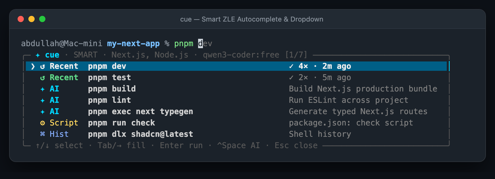
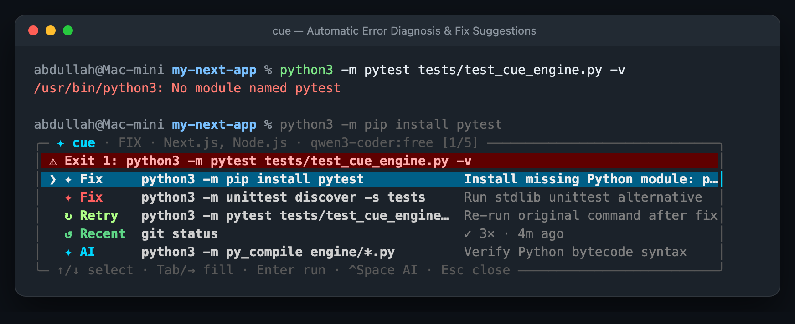
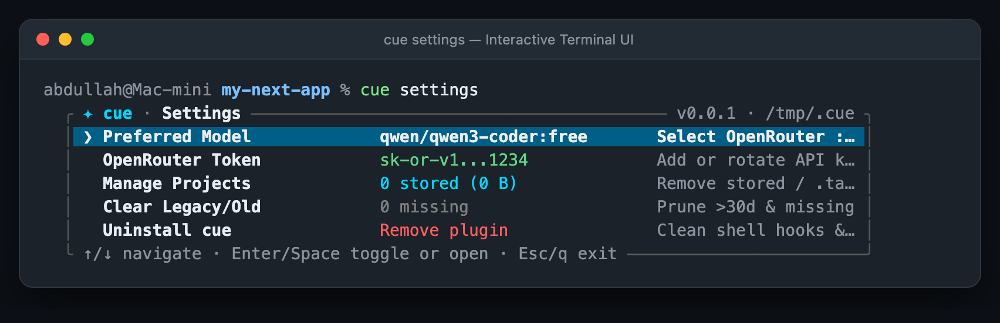

# cue - Smart AI Zsh Autocomplete & Project History Dropdown

`cue` is a modern Zsh plugin that pairs **inline ghost-text suggestions** and an **interactive Up/Down arrow dropdown** with **automatic project analysis**, **project-scoped command history**, and **OpenRouter `:free` AI models**.



---

## Features

- **Interactive ZLE Dropdown & Ghost Text**
  - Renders directly below your prompt via Zsh Line Editor (`POSTDISPLAY` + `region_highlight`) without polluting terminal scrollback.
  - Combines five prioritized sources in one ranked view:
    - `✦ Fix`: Instant diagnostic & AI fixes automatically surfaced when a command fails
    - `↻ Retry`: Re-suggests your original failed command after a fix succeeds
    - `↺ Recent`: Recent commands executed in the current project (max 3 in suggestion box)
    - `✦ AI`: Smart, project-aware commands from OpenRouter `:free` models (max 12)
    - `⚙ Script`: Auto-detected runnable scripts and targets (`package.json`, `Makefile`, `pyproject.toml`, `Cargo.toml`, `docker-compose.yml`, etc.)
    - `⌘ Hist`: Global shell history
  - Pure Zsh in-memory + TSV cache lookups keep keystrokes instantaneous; AI calls run asynchronously via a FIFO + `zle -F` file descriptor.
- **Automatic Folder Resume & Silent Background Analysis**
  - On terminal startup or `cd`, `cue` checks `~/.cue/projects/` first to resume any existing project context immediately, or creates one automatically.
  - Project analysis runs silently in the background without prompting for permission.
- **Automatic Error Diagnosis, Dimmed Fix Ghost & Auto-Retry**
  - When a command fails (non-zero exit code, excluding `Ctrl+C`), `cue` diagnoses common issues locally in milliseconds (e.g., `No module named pytest`, missing binaries, `chmod +x`, git/npm/docker failures) and shows the fix command immediately as **dimmed inline ghost text** right on your prompt.
  - Press **`Tab`** to accept the fix command (or just start typing to write your own command), press `↓` to see alternate fixes, and once your fix succeeds, `cue` automatically suggests your original failed command next in dimmed text so you can re-run it with `Tab` + `Enter`.
- **Priority Ordering**
  - Project suggestions prioritize: **active error fixes / post-fix retry** → **Recent project commands (max 3)** → **AI suggestions (max 12)** → **Scripts & Shell History**.
- **Low-Latency OpenRouter Free Models + Automatic Fallback**
  - Enforces `:free` models only (`is_free_model` rejects paid models), reuses HTTPS keep-alive connections via an optional localhost daemon (`cue daemon`), ranks models by observed response latency, and automatically switches on `429`/provider limits while preserving project & session context.
- **Cross-Platform (macOS, Linux & Windows)**
  - Native **Zsh** plugin (`cue.plugin.zsh`), **Bash** adapter (`bash/cue.bash` for Linux/macOS/WSL/Git Bash), and **PowerShell** adapter (`powershell/cue.ps1` + `install.ps1` for Windows 10/11 & `pwsh`).
- **Self-Contained Context & Size Management (`~/.cue`)**
  - Stores everything inside `~/.cue/` (overridable via `CUE_HOME`).
  - Filters out commands containing inline secrets/tokens/keys before saving.
  - Enforces a **256 KB** per-project context cap, a **20 MB** total projects LRU cap, and **512 KB** rotating logs.
  - Includes `cue context clear` tools to delete missing/deleted folders, stale contexts (`--older-than 30d`), or specific projects.

---

## Screenshots

### Automatic Error Diagnosis, Dimmed Fix Ghost & Retry



### Interactive Settings TUI (`cue settings`)



---

## Requirements

- **Zsh** `5.x` (tested on Zsh 5.9)
- **Python 3** (uses Python standard library only; no `pip install` required)
- **git** (optional, used for repository root resolution and branch/status context)

---

## Installation

### Option 1: One-Line Installer (macOS / Linux)

```bash
curl -fsSL https://raw.githubusercontent.com/abdullahmia/Cue/main/install.sh | bash
```

This clones `cue` into `~/.local/share/cue` (override with `CUE_INSTALL_DIR`), makes `bin/cue` executable, links Oh My Zsh if detected, and appends `source ".../cue.plugin.zsh"` to `~/.zshrc` (and `bash/cue.bash` to `~/.bashrc` when present).

Then reload your shell to start interactive onboarding:

```zsh
source ~/.zshrc
```

---

### Option 2: Homebrew (macOS / Linux)

```zsh
brew tap abdullahmia/cue https://github.com/abdullahmia/Cue.git
brew install abdullahmia/cue/cue-zsh
```

Activate the Zsh plugin in `~/.zshrc` and reload:

```zsh
echo 'source "$(brew --prefix)/opt/cue-zsh/share/cue-zsh/cue.plugin.zsh"' >> ~/.zshrc
source ~/.zshrc
```

---

### Option 3: Zsh Plugin Managers

**Oh My Zsh:**

```zsh
git clone https://github.com/abdullahmia/Cue.git "${ZSH_CUSTOM:-$HOME/.oh-my-zsh/custom}/plugins/cue"
```

Add `cue` to `plugins=(...)` in `~/.zshrc` and run `source ~/.zshrc`:

```zsh
plugins=(git cue)
```

**Zinit:**

```zsh
zinit light abdullahmia/Cue
```

**Sheldon (`~/.config/sheldon/plugins.toml`):**

```toml
[plugins.cue]
github = "abdullahmia/Cue"
```

---

### Option 4: Manual Clone

```zsh
git clone https://github.com/abdullahmia/Cue.git ~/.local/share/cue
cd ~/.local/share/cue
./install.sh
source ~/.zshrc
```

Or source directly in `~/.zshrc` without running `install.sh`:

```zsh
source ~/.local/share/cue/cue.plugin.zsh
```

---

### Option 5: Windows PowerShell (`powershell.exe` or `pwsh`)

```powershell
git clone https://github.com/abdullahmia/Cue.git $HOME\cue
cd $HOME\cue
.\install.ps1
```

Or dot-source directly in `$PROFILE`:

```powershell
. "$HOME\cue\powershell\cue.ps1"
```

---

### Option 6: Bash (Linux / macOS / Git Bash)

```bash
source ~/.local/share/cue/bash/cue.bash
```

---

### Updating & Uninstalling

- **Update (One-Line / Git):** re-run `curl -fsSL https://raw.githubusercontent.com/abdullahmia/Cue/main/install.sh | bash` (or `git -C ~/.local/share/cue pull`).
- **Update (Homebrew):** `brew update && brew upgrade cue-zsh`
- **Uninstall:** run `cue uninstall` (interactive prompt lets you keep or purge `~/.cue` data; removes `~/.zshrc` / `~/.bashrc` / Oh My Zsh hooks cleanly). For Homebrew installs, also run `brew uninstall cue-zsh`.

---

## First-Session Onboarding & Changing Token

When you open your first interactive Zsh session with `cue` loaded (and `~/.cue/config.json` does not exist yet), the setup wizard starts automatically:

1. Prompts for your OpenRouter API key (get a free key at `https://openrouter.ai/keys`, or press `Enter` to skip and use local project history/scripts mode).
2. Verifies the key against OpenRouter, fetches available `:free` models, and selects a default free model.
3. Saves configuration to `~/.cue/config.json` with `0600` permissions and analyzes your current directory.

You can re-run onboarding anytime with `cue onboard --force`, change your OpenRouter token anytime with `cue token` (or `cue token <new-key>`), or supply a key via `OPENROUTER_API_KEY` in your environment.

---

## Keybindings

| Key | Behavior |
| --- | --- |
| `↓` (Down Arrow) | Open smart dropdown (or move selection down) |
| `↑` (Up Arrow) | Open history-first dropdown with most recent command selected (or move selection up) |
| `Tab` or `→` | Fill prompt buffer with the selected command / accept inline ghost text |
| `Enter` | Execute selected command (if navigated with `↑`/`↓`), or execute what you typed |
| `Ctrl+Space` or `Ctrl+X Ctrl+A` | Trigger an immediate live AI refresh for the current input |
| `Esc` or `Ctrl+G` | Dismiss the dropdown |

> **Note:** Normal `Tab` completion (`expand-or-complete`) is preserved whenever no dropdown item is actively highlighted with `↑`/`↓`.

---

## CLI Reference

### Core Commands

```zsh
cue status                         # API status, prompt mode, active :free model, and storage usage
cue settings                       # Interactive TUI: Prompt Mode, Models, Token, Remove Projects, Uninstall
cue ask "<prompt>"                 # Translate free-text prompt to runnable commands (alias: `cue prompt`)
cue history [--limit N]            # Modern TUI table of recent commands in the current project
cue onboard [--force]              # Run (or re-run) the interactive setup wizard
cue token [NEW_KEY]                # Change your OpenRouter API token anytime (alias: `cue key`)
cue fix [FAILED_CMD]               # Diagnose a failed command and show fix suggestions
cue analyze [--dir PATH] [--force] [--no-ai] [--json]
                                    # Resume or create ~/.cue (or ~/.cuee) context & analyze folder
cue suggest [--dir PATH] [--input TEXT] [--mode auto|complete|prompt] [--live] [--limit N] [--tsv | --json]
                                    # Print ranked suggestions (add --live to query OpenRouter)
cue daemon [--ensure | --stop]     # Inspect, start, or stop the low-latency keep-alive daemon
cue uninstall [--purge | --keep-data]
                                    # Remove cue hooks from shell profiles (and optionally delete data)
```

### Free Model Management

```zsh
cue models                         # List :free models, active model, and cooldown status
cue models --refresh               # Refresh live :free models list from OpenRouter
cue models --use <model-id:free>   # Set preferred :free model (paid models are rejected)
cue models --reset-health          # Clear all rate-limit/error cooldowns
```

### Context & Legacy Project Cleanup (`~/.cue/projects/`)

```zsh
cue context list                   # Table of stored projects, stacks, file sizes, age, & status
cue context stats                  # Storage breakdown inside ~/.cue vs configured caps
cue context clear                  # Interactive selector (supports numbers, 'missing', or 'old')
cue context clear --current        # Delete context for the current project
cue context clear --missing        # Delete context files for folders that no longer exist
cue context clear --older-than 30d # Delete contexts unused for N days/weeks/hours (e.g. 30d, 2w, 12h)
cue context clear <name-or-id>     # Delete a specific project's context file by name, path, or ID
cue context clear --all [--yes]    # Delete all stored project context files
```

### Configuration

```zsh
cue config show                    # Print ~/.cue/config.json (API key redacted)
cue config set-key [KEY]           # Set and verify a new OpenRouter API key
```

---

## Configuration & Environment Variables

Settings live in `~/.cue/config.json`:

| Key | Default | Description |
| --- | --- | --- |
| `openrouter_api_key` | `""` | OpenRouter API key (fallback to `$OPENROUTER_API_KEY` if unset) |
| `preferred_model` | `"qwen/qwen3-coder:free"` | Preferred `:free` model ID |
| `free_models_only` | `true` | Always enforced to `true` |
| `prompt_mode` | `false` | Enable free-text natural-language prompts directly on the terminal (`cue settings` to toggle) |
| `auto_analyze` | `true` | Automatically analyze folders on entry |
| `ai_debounce_ms` | `450` | Debounce delay for live typing AI queries |
| `max_project_bytes` | `262144` (256 KB) | Maximum size per project JSON file before compaction |
| `max_total_bytes` | `20971520` (20 MB) | Total projects storage cap before LRU eviction |
| `max_log_bytes` | `524288` (512 KB) | Log file rotation threshold |
| `legacy_retention_days` | `30` | Default threshold for interactive `old` cleanup |
| `max_dropdown_items` | `7` | Visible rows in the ZLE dropdown viewport |

Supported environment variables:

- `CUE_HOME`: Override storage directory (default: `~/.cue`).
- `CUE_NO_ONBOARD=1`: Skip automatic onboarding prompt on shell startup.
- `CUE_PYTHON`: Override Python executable path (default: `python3`).
- `OPENROUTER_API_KEY`: Fallback API key if not stored in `config.json`.
- `NO_COLOR`: Disable ANSI colors in CLI output.

---

## Storage Layout (`~/.cue` or `~/.cuee`)

`cue` creates `~/.cue` by default. If an unrelated `~/.cue` file or directory already existed before installing `cue`, it automatically uses **`~/.cuee`** instead.

```text
~/.cue/
├── config.json              # API key (0600), size caps, preferences
├── state.json               # Active :free model & fallback telemetry
├── models_cache.json        # Cached OpenRouter :free models (6h TTL)
├── model_health.json        # Cooldown tracking per model after 429/errors
├── cache/
│   ├── dir_map.tsv          # Fast path -> project_id lookup for Zsh
│   ├── proj_<id>.tsv        # Pre-ranked suggestions for zero-latency ZLE rendering
│   └── notify_<pid>.fifo    # Async notification pipe for zle -F
├── logs/
│   └── cue.log             # Rotating log file (512 KB cap)
└── projects/
    ├── index.json           # Registry of tracked projects
    └── <name>-<hash>.json   # Tech stack, scripts, git state, recent commands, & AI context
```

---

## Project Structure & Testing

```text
cue/
├── cue.plugin.zsh          # Zsh plugin entrypoint
├── Formula/cue-zsh.rb      # Homebrew single-repo tap formula
├── install.sh              # One-line / local installer (macOS & Linux)
├── install.ps1             # Windows PowerShell installer
├── uninstall.sh / .ps1     # Clean shell uninstaller scripts
├── bin/cue                 # CLI executable
├── zsh/                    # ZLE dropdown, hooks, and UI wrapper
├── bash/cue.bash           # Bash shell adapter
├── powershell/cue.ps1      # PowerShell adapter
├── engine/                 # Python stdlib engine (CLI, daemon, context, OpenRouter, TUI)
├── assets/                 # README screenshots
└── tests/
    ├── test_cue_engine.py       # Python unit & integration tests
    └── test_zsh_integration.zsh # Zsh syntax & ZLE dropdown verification
```

Run the test suite:

```zsh
python3 -m unittest discover -s tests -p "test_*.py" -v
zsh tests/test_zsh_integration.zsh
```

### Development & Commit Conventions

This repository uses **Husky** and **commitlint** (`@commitlint/config-conventional`):

```zsh
npm install
```

- `pre-commit`: verifies Python bytecode compilation, Zsh/Bash syntax, and unit tests.
- `commit-msg`: enforces [Conventional Commits](https://www.conventionalcommits.org/) (`feat:`, `fix:`, `docs:`, `refactor:`, `test:`, `chore:`, etc.).
